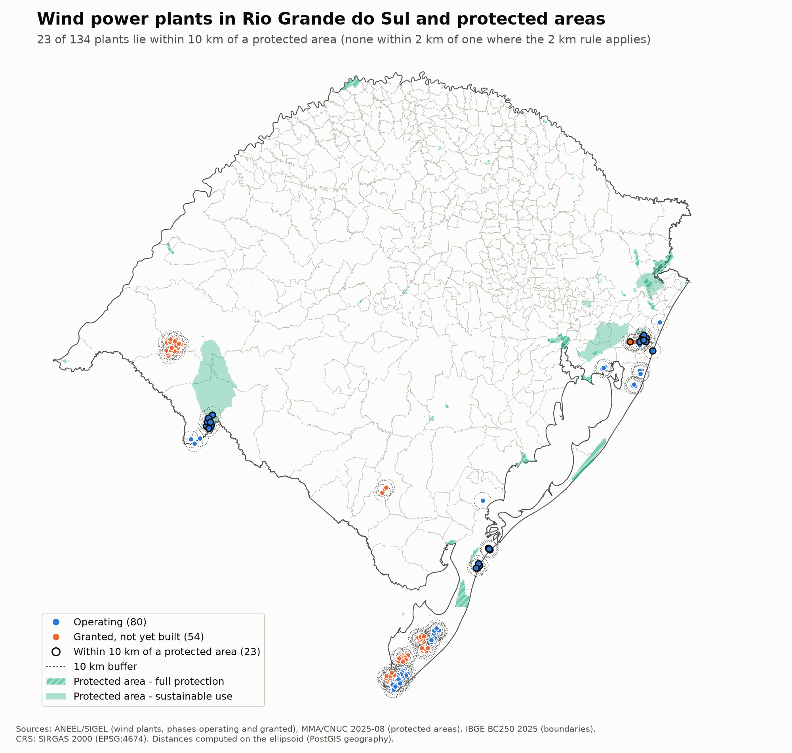

# Wind power plants in Rio Grande do Sul: a PostGIS + Python spatial analysis

How close are the wind power plants of Rio Grande do Sul (RS), Brazil, to protected
areas and to the towns of the municipalities that host them?

This is a personal project built end to end with **PostgreSQL/PostGIS** and **Python**:
official open data is loaded into a spatial database, analysed with spatial SQL, and
turned into a map, with one command. It builds on my master's research on the
socio-environmental impacts of wind energy in Brazil.



## Key results

134 wind power plants in RS (80 operating, 54 granted but not yet built).

**Protected areas**

| | Plants |
|---|---|
| Inside a protected area | 1 |
| Within 2 km of a protected area (any category) | 3 |
| Within 2 km of a protected area where the 2 km licensing rule applies | **0** |
| Within 10 km of a protected area | **23 (17%)** |

- All plants within 2 km of a protected area are next to an *Área de Proteção Ambiental*
  (APA), a category to which the current 2 km rule does not apply. The closest case is
  the APA do Ibirapuitã, with 7 plants within 10 km and one plant inside it.
- Under the former 10 km rule (see *Method*), 23 plants would fall within the
  surrounding area of a protected area.

**Distance to municipal seats (town centres)**

| Phase | Plants | Mean distance to own seat | Min | Max | Closer to another municipality's seat |
|---|---|---|---|---|---|
| Operating | 80 | 23.0 km | 3.0 km | 69.1 km | 11 |
| Granted, not yet built | 54 | 35.3 km | 5.7 km | 94.5 km | 9 |

- Plants not yet built are, on average, further from towns than operating ones.
- 20 of 134 plants (15%) are closer to the seat of a neighbouring municipality than to
  the seat of the municipality where they are located.

Full tables: [`output/plant_seat_distance.csv`](output/plant_seat_distance.csv) and
[`output/plant_protected_area.csv`](output/plant_protected_area.csv).

## Workflow

```
data/raw (shapefiles, GeoPackage)
   │  scripts/01_carga.py      geopandas: filter RS, clean, fix codes, load
   ▼
PostGIS database "eolicas_rs"  wind_plants, protected_areas, municipal_seats
   │  sql/02_analise.sql       spatial SQL: KNN, geodesic distances, buffers, ST_DWithin
   ▼
result tables                  plant_seat_distance, plant_buffers, plant_protected_area
   │  scripts/03_mapa.py       read from PostGIS, map + CSV export
   ▼
output/                        map_wind_plants_rs.png, *.csv
```

`scripts/run_all.py` runs the three steps in order and stops if a data check fails.

## Method

**Data (all public, Brazilian official sources)**

| Layer | Source | Notes |
|---|---|---|
| Wind power plants | ANEEL – SIGEL, layer "Central Geradora Eólica – EOL" (downloaded Nov 2026) | 268 plants in RS; kept phases *Operação* (80) and *Construção não iniciada* (54) |
| Protected areas | MMA – CNUC, "Polígono CNUC 2025_08" | 101 areas touching RS |
| Municipal seats and boundaries | IBGE – BC250, 2025 version (GeoPackage) | 497 seats in RS (layers `lml_cidade_p`, `lml_municipio_a`) |

**Main choices**

- **Phases.** Only operating plants and plants already granted are analysed. Plants
  with only a registration of intent (DRO), expired or revoked were excluded, as many
  never get built.
- **Coordinate system.** Data is stored in SIRGAS 2000 (EPSG:4674). RS spans two UTM
  zones (21S and 22S), so a single UTM projection would distort distances in the west
  of the state. Distances and buffers are computed on the ellipsoid with the PostGIS
  `geography` type, which gives metres everywhere in the state.
- **Nearest seat (KNN).** The `<->` operator uses the spatial index but ranks by
  planar distance in degrees. The query takes the 5 nearest candidates through the
  index and then picks the closest by true geodesic distance.
- **Two radii, based on Brazilian environmental licensing rules.**
  - 2 km: CONAMA Resolution 428/2010, art. 5, III (as amended by CONAMA 508/2025) —
    in licensing processes not subject to a full environmental impact study (EIA/RIMA),
    the protected-area manager must be notified when a project lies within 2,000 m of
    a protected area whose buffer zone has not been established. The 2025 amendment
    removed the former 5-year time limit on this rule. It does not apply to APAs,
    private reserves (RPPNs) or consolidated urban areas.
  - 10 km: the former CONAMA Resolution 13/1990 (revoked in 2010) — any activity that
    could affect the biota within a 10 km radius of a protected area had to be licensed,
    and the licence required the authorisation of the protected-area manager (not just a
    notification, as in the current rule).
  - Proximity is tested with `ST_DWithin` on `geography` (exact distance, index-assisted);
    buffer polygons are only used for the map.

**Data quality checks**

- **Municipality codes.** The analysis joins each plant to its municipal seat by the
  7-digit IBGE code. A check query found 2 plants whose ANEEL record stores only the
  first 6 digits (e.g. Rio Grande (RS) as `431560` instead of `4315602`). Those plants
  were silently dropped from the averages. The load script now completes the code from
  the IBGE seats table (the 6-digit prefix is unique) and stops if any plant is still
  unmatched.
- **Text encoding.** The CNUC attribute table declares UTF-8 but contains a value cut in
  the middle of an accented character, which breaks a plain UTF-8 read. The load script
  reads it as Latin-1 and re-decodes it, replacing only the broken bytes.
- **Duplicates.** Plant codes (CEG) repeat in RS only among excluded phases; after
  filtering, CEG is unique and used as the primary key.

## Limitations

- When a protected area has an established buffer zone in its management plan, that
  zone applies instead of the 2 km rule. CNUC does not provide buffer-zone boundaries,
  so the 2 km rule is used as an approximation.
- CNUC only includes registered protected areas; unregistered municipal or state areas
  are missing. Polygon quality also varies: of the 101 areas, 51 match the legal
  description, 43 are estimates and 7 are schematic.
- Plants are points (one coordinate per plant), not the footprint of each turbine.
- The 2 km notification rule covers licensing processes not subject to EIA/RIMA; projects
  licensed with a full EIA/RIMA follow a different procedure (authorisation by the
  protected-area manager when the area or its buffer zone is affected). The licensing
  type of each plant is not part of the data, so the 2 km radius is used as a reference
  distance for all plants.
- This is a spatial proximity analysis. It does not assess the licensing of any plant.

## How to run

Requirements: PostgreSQL with PostGIS (built with PostgreSQL 19 + PostGIS 3.7 on
Windows) and Python 3.14.

1. Create the database and enable PostGIS:
   ```sql
   CREATE DATABASE eolicas_rs;
   -- connect to eolicas_rs, then:
   CREATE EXTENSION postgis;
   ```
2. Download the source data (links below) into `data/raw/`. The IBGE GeoPackage
   (~1.5 GB) can stay elsewhere: set its path in the `BC250_GPKG` environment variable.
3. Install the Python packages and run:
   ```
   python -m venv .venv
   .venv\Scripts\activate
   pip install -r requirements.txt
   python scripts\run_all.py
   ```
   The PostgreSQL password is asked at run time (or read from `PGPASSWORD`); it is never
   stored in the code.

**Data sources**

- ANEEL – SIGEL: https://sigel.aneel.gov.br
- MMA – Unidades de Conservação (CNUC): https://dados.mma.gov.br/dataset/unidadesdeconservacao
- IBGE – BC250, 2025 version: https://geoftp.ibge.gov.br/cartas_e_mapas/bases_cartograficas_continuas/bc250/versao2025/

## Tools

PostgreSQL 19, PostGIS 3.7, pgAdmin 4, Python 3.14 (geopandas, pyogrio, shapely,
SQLAlchemy, GeoAlchemy2, psycopg2, matplotlib), QGIS for data inspection.

## Author

Gabriel Horner Rodrigues — geographer, MSc candidate in Environmental Analysis
(UFPel, Pelotas (RS), Brazil).
